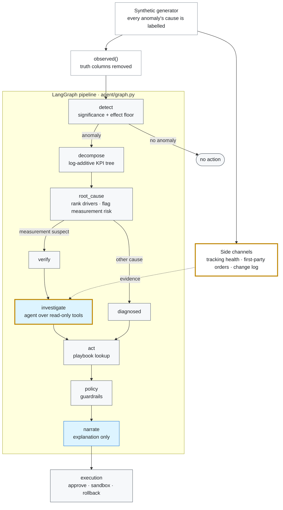
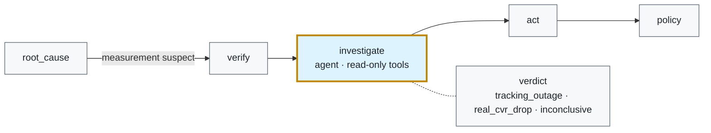
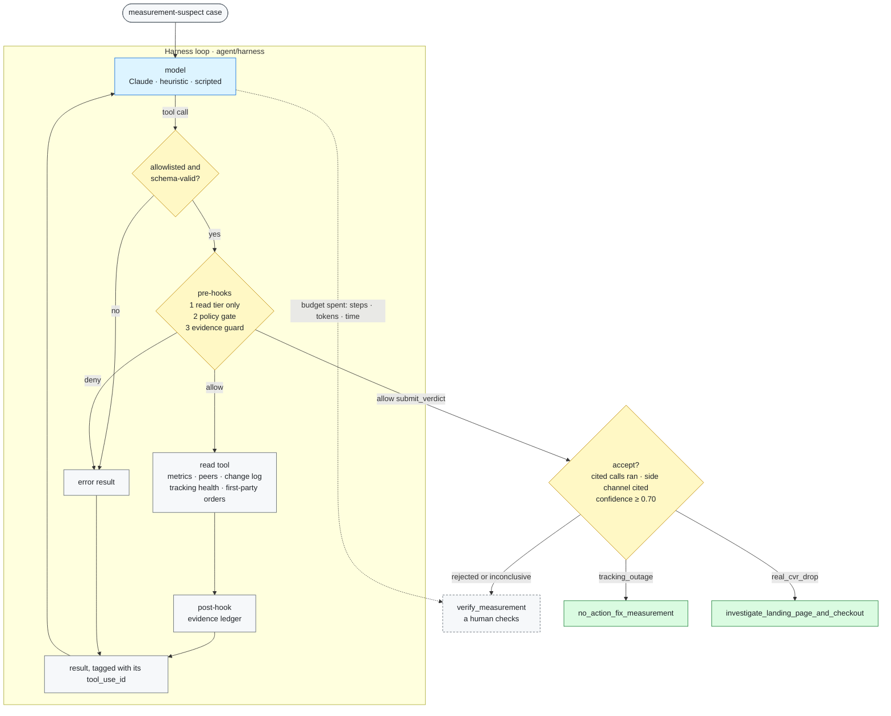

# Architecture

An agent that diagnoses why an ad campaign's performance moved, proposes a response,
and gates that response behind policy and human approval — evaluated end to end
against known ground truth.

This document is the design rationale. The [README](README.md) covers the data model;
`python demo.py` walks the load-bearing case through every stage.

---

## 1. The problem, and why it is hard

An analyst asks: *"Beauty US CPA spiked 200% last week — what do I do?"* The honest
answer depends on a fact the reported numbers cannot show you. If the conversion
rate really fell, you investigate checkout. If the conversion *tracking* broke, the
funnel is fine and cutting bids would destroy healthy volume. **In the observed data
these two are identical** — reported conversions collapse, CPA spikes, ROAS falls,
clicks and spend stay flat — and the difference decides whether the correct action
is "investigate" or "do nothing."

That is the whole design problem: build an agent that acts decisively on real
anomalies while refusing to act confidently on ones it cannot distinguish from a
measurement artifact.

## 2. Why synthetic data

No production ads log carries a column saying *this CPA spike was a competitor
entering the auction* versus *a postback pipeline dropping conversions*. Without
labels the problem is not evaluable at all. So the data is generated with the root
cause of every anomaly **known and recorded** (`data/events.py` — the `KINDS`
registry is the answer key), and four choices keep the agent from gaming its own
benchmark:

- anomalies are injected on **drivers** (impressions, ctr, cpc, cvr, aov) or an
  observation knob (reporting_rate), **never on reported outcomes** — so attribution
  is well-posed, not tautological;
- counts are **sampled** (Poisson/Binomial), so "is this move significant?" cannot
  degenerate into a tuned threshold;
- events **overlap** on one campaign (confounds), so "name the largest delta" loses;
- exactly one **measurement artifact** exists per scenario, so the eval rewards
  correctness, not confidence.

The `observed()` seam in `data/schema.py` is what keeps scoring honest: agent code
that reaches a truth column has to deliberately route around a function named
`observed`.

## 3. The billing model *is* the physics

The advertiser pays per click (CPC). That fixes which metrics can move which:

```
clicks = impressions·ctr   spend = clicks·cpc   conversions = clicks·cvr   revenue = conversions·aov
⇒  cpa = cpc/cvr           roas = (cvr·aov)/cpc
```

Two consequences drive everything downstream:

- **CPA depends on exactly two drivers, `cpc` and `cvr`.** Nothing else can move it.
- **CTR is in neither CPA nor ROAS.** Under CPC billing a CTR drop is a *volume*
  problem — fewer clicks, proportionally less spend, identical cost per conversion.
  An agent that answers a CTR drop with a bid change has misread the billing model.

Every stage respects these identities because they are encoded once (the decomposition
tree, the simulator) and reused, rather than re-derived per stage.

## 4. The core principle: deterministic core, LLM overlay

> The language model narrates. It never decides anything that moves money.



<sub>**Grey:** deterministic code. **Blue:** a model runs here. **Gold border:** added with the investigator ([§10](#10-build-plan-investigator-agent--harness)). **Dashed arrow:** read-only evidence.</sub>

The LLM (`agent/diagnosis.py`, `claude-opus-5-5`, structured output via
`messages.parse`) is handed *only* the deterministic evidence — never truth columns —
and writes the human-readable explanation. It cannot invent a root cause the
deterministic stages did not find, and it cannot choose the action. This is where the
project puts the model and, more importantly, where it does **not**.

The investigator (§10) adds one more, narrower model role: on the measurement-suspect
branch only, an agent decides *what is true* from read-only evidence. It still cannot
choose an action; its verdict only selects a playbook row.

## 5. The stages

| Stage | File | What it does | Key decision |
|---|---|---|---|
| Detect | `agent/detect.py` | two-proportion z (rates), Welch t (counts/ratios) | significance **and** a ≥10% effect floor — pure significance over-fires on huge campaigns |
| Decompose | `agent/decompose.py` | Δlog(KPI)=Σ ±Δlog(driver) down the identity tree | count KPIs use **per-day** levels, so a 2-wk window vs 4-wk baseline is period-length invariant |
| Root cause | `agent/root_cause.py` | significant driver with the largest log-move; confounds ranked | raises `measurement_suspect` on any cvr-down signature |
| Investigate | `agent/investigator/` | agent loop over read-only tools and side channels | runs only on the measurement-suspect branch; any failed check falls back to `verify_measurement` |
| Narrate | `agent/diagnosis.py` | LLM explanation | injected into the graph; the graph never imports the SDK |
| Act | `agent/actions.py` | driver → analyst playbook | a measurement-suspect signature is **never** a bid/budget cut |
| Policy | `agent/policy.py` | approve / require_approval / block | most-restrictive-wins over independent guardrails |
| Execution | `agent/execution.py` | approval, sandbox, rollback | a block **cannot be clicked through** |

The stages are wired into a **LangGraph** state machine (`agent/graph.py`). A linear
pipeline does not strictly need a graph; what earns it is the **conditional routing**,
and one edge in particular: a `measurement_suspect` anomaly is routed to a
verification gate *before* it can reach any action node. The trap-handling is visible
in the topology, not buried in a node.

## 6. Safety is structural, and defended twice

The one failure mode that does real damage is a confident action on a measurement
artifact. It is stopped in **two independent places**:

1. **Action layer** (`actions.py`) refuses to *recommend* a bid/budget cut on a
   measurement-suspect signature — it returns `verify_measurement`, the safe common
   prefix of both correct responses (fix the pipeline if it broke; investigate
   checkout if it did not).
2. **Policy gate** (`policy.py`) independently *blocks* any money-moving cut on that
   signature, even if some upstream change let one through. Two layers would have to
   break together to destroy volume.

And at execution (`execution.py`), a `block` is a **hard stop, not a stricter
approval** — `approve()` and `apply()` both raise on a blocked change. You do not
override the block; you fix the tracking and re-run the diagnosis, at which point the
signature is no longer suspect. The other guardrails bound an *executable*
intervention — spend ceiling, break-even ROAS floor, volume-loss limit, confidence
floor — reading the week-8 projection, so they cannot violate the billing identities
either. Every applied change carries its exact inverse, so rollback restores the
account to floating-point epsilon.

## 7. Evaluation methodology

Robustness and generalisation are different questions, tested differently:

- **Seed robustness** (noise): the same scenario, resampled — `SEED_OFFSET` re-runs
  the whole test suite across noise draws.
- **Cross-validation** (overfitting): `tools/evaluate.py` scores over *independent*
  `sample_scenario` draws — different campaigns, windows, magnitudes, timing — each
  with its own answer key. One dataset is an anecdote; twenty is a result. Every hard
  case (a confound, a linear ramp, a tracking outage on the noisiest campaign) is
  *always* present; the easy cases are *randomly* placed, so nothing can be memorised.

The metric that matters most is not accuracy. It is **the harmful-action rate on the
measurement artifact** — and its end-to-end companion, whether a proposed cut on that
artifact is *blocked by the gate and refused by the executor*.

### Results (20 cross-validation scenarios)

| Metric | Result | Target |
|---|---|---|
| Detection recall | 100% ± 0 | high |
| False-positive rate (untouched campaigns) | 3.3% ± 10 | ~0 |
| Root-cause accuracy | 100% ± 0 | high |
| Action accuracy | 100% ± 0 | high |
| Harmful recommendation on artifact | 0% ± 0 | 0 |
| Gate auto-approved an artifact cut | 0% ± 0 | 0 |
| Blocked **and** refused an artifact cut | 100% ± 0 | 1 |

The false-positive rate is deliberately non-zero: a significance detector has some,
and the number is honest. It was *higher* (13%) until tracing showed a far-back
baseline let the portfolio's slow trend clear the effect floor — fixed by comparing
against the nearest clean window, the production-realistic choice, not by tuning the
threshold until the number looked good.

## 8. Interview talking points

- **Where NOT to put an LLM.** The model writes prose; a table lookup on a
  deterministic root cause chooses the money-affecting action. You do not want a
  language model free-choosing between "cut bids" and "do nothing" on a real budget.
- **Encoding a domain invariant in tests.** `test_ctr_drop_is_a_volume_event_and_does_not_touch_cpa`
  makes the CPC billing model a property the whole pipeline must satisfy.
- **Designing an eval you can't game.** The four data choices in §2, plus
  cross-validation over randomised scenarios with the hard cases always present.
- **Anti-overfitting discipline.** A 13% false-positive rate was *explained and fixed
  at the source*, not tuned away. The residual 3% is left because zero would signal an
  overfit.
- **Fail-safe defaults.** Most-restrictive-wins at the gate; a block that cannot be
  clicked through; a false measurement-suspect costs one verification step, a missed
  one destroys volume — the asymmetry decides the default.

## 9. Reproduce

```bash
python -m pytest tests/ -q                 # 172 passed + 3 skipped (3 LLM tests need a key)
python demo.py                             # the trap through every stage, end to end
python -m tools.evaluate --n 20            # the full graded harness
```

---

## 10. Build plan: investigator agent + harness

### Why

Through §9 the system is a *workflow*: every step is a fixed edge, and the model only
narrates. That is the right call for anything that moves money, but it leaves the
hardest question unanswered. On a `measurement_suspect` signature the pipeline stops
at "verify measurement" and hands the ambiguity to a human, because the observed panel
cannot tell a tracking outage from a real checkout regression.

That ambiguity is exactly the job an agent is good at: open-ended, multi-step evidence
gathering where no single source is decisive. No money moves while it investigates. So the
agent goes **there** and nowhere else:



The principle is unchanged, only refined. **The agent may now decide what is true;
it still never chooses an action that moves money.** A verdict selects a row of the
playbook (`no_action_fix_measurement` or `investigate_landing_page_and_checkout`), and
`policy.py` still blocks any bid/budget cut on the signature.

### Design

**Side-channel evidence (`data/telemetry.py`).** The observed panel is identical under
both hypotheses *by construction*, so the agent needs evidence outside the panel. In
production these sources exist; here they are simulated from the truth with noise and
decoys, so none of them is a free answer:

| Source | Under a tracking outage | Under a real CVR drop | Why it is not decisive alone |
|---|---|---|---|
| tracking health: pixel tag-fire rate (web) / MMP postback success (app) | drops | flat | independent monitor glitches dip it with no real effect; noisy on small campaigns |
| first-party orders (advertiser backend) | flat | drops | includes organic orders; Poisson noise; small campaigns are jumpy |
| change log | sometimes a tag/SDK change | sometimes a site release | entries are probabilistic, and unrelated decoy changes are everywhere |

Telemetry uses its own RNG stream, so every existing dataset and test is byte-identical.

**Harness (`agent/harness/`).** The runtime that makes a model + tools into a bounded,
auditable agent, independent of this domain:

- *Tool registry*: name, description, JSON schema, handler, **permission tier**
  (`read` / `write`), terminal flag. The agent only sees an explicit allowlist.
- *Model client protocol*: `AnthropicClient` (Messages API tool use, prompt-cached
  system + tools) and `ScriptedClient` (deterministic policies for offline tests and
  the rule-based baseline). The loop never imports the SDK.
- *Loop*: step, token, and wall-clock **budgets**; input validation against the schema;
  tool errors returned to the model as `is_error` results, never raised; tool output
  truncated to bound context growth.
- *Hooks*: `pre_tool` / `post_tool`. **`policy.py` becomes a PreToolUse hook.** Any
  `write`-tier tool call is routed through the same guardrails, so a bid cut on a
  suspect signature is denied *inside* the agent loop as well as at the executor.
- *Trace*: every model turn, tool call, hook decision, and stop reason with latency and
  tokens, exportable as JSONL. This is what the trajectory evals read.

**Investigator (`agent/investigator/`).** Tools: `get_pipeline_diagnosis`,
`query_metrics`, `check_tracking_health`, `get_first_party_orders`, `get_change_log`,
`compare_peers`, and the terminal `submit_verdict(hypothesis, confidence, evidence[])`.
The harness **validates the verdict** before anything downstream sees it:

- every piece of evidence must cite a tool call that actually ran and succeeded;
- a decisive verdict requires that the agent consulted at least one side-channel
  source (tracking health or first-party orders), which is a trajectory rule;
- low confidence, a failed check, or an exhausted budget all **fall back to the
  deterministic `verify_measurement`**, the pre-agent behaviour.

A `HeuristicPolicy` drives the same tools through the same harness with fixed rules. It
gives an offline baseline the LLM agent has to beat, and it runs the whole stack in CI
without an API key.

**One investigation, end to end.**



<sub>**Yellow:** checks the model cannot talk its way past. **Green:** an accepted verdict selects a playbook row. **Dashed:** the fallback, which is the pre-agent behaviour. Every model mistake comes back as an error result it can recover from, and every resource it can burn ends in a stop reason.</sub>

### Checklist

- [x] 1. `data/telemetry.py`: tracking health, first-party orders, change log; separate RNG; decoys; tests
- [x] 2. `agent/harness/`: registry + tiers, model clients, loop + budgets, hooks (policy gate as PreToolUse), trace; tests incl. a rogue model
- [x] 3. `agent/investigator/`: tools, prompt, verdict validation + fallback, heuristic policy; tests
- [x] 4. Graph wiring: `verify → investigate → act`; verdict-aware `recommend`; cut still blocked; `tools/ask.py --investigator`
- [x] 5. Eval: `tools/evaluate.py --investigator none|heuristic|llm`, with resolution accuracy, confidently-wrong rate, inconclusive rate, trajectory compliance, citation validity, steps/tokens per case; safety metrics unchanged
- [x] 6. Docs: results table + interview talking points here and in README; model IDs updated

### Results (20 cross-validation scenarios, 40 measurement-suspect cases)

```bash
python -m tools.evaluate --n 20 --investigator heuristic
python -m tools.evaluate --n 20 --investigator llm --trace-dir traces/    # needs ANTHROPIC_API_KEY
```

| Metric | No agent | Heuristic investigator | LLM investigator |
|---|---|---|---|
| Resolution accuracy (decisive and correct) | 0% (all verify) | 60% (tracking 13/20, real 11/20) | *run with a key* |
| Confidently wrong | 0% | **0%** | |
| Inconclusive → verify_measurement | 100% | 40% | |
| Trajectory: accepted verdicts used a side channel | n/a | 100% | |
| Harmful reco / auto-approved / blocked+refused cut on artifact | 0% / 0% / 100% | 0% / 0% / 100% | |
| Turns / tool calls per case | n/a | 5 / 5 | |

**First live case** (`claude-sonnet-5-5`, demo event `e004`, which is an outage that coincides
with an organic demand dip; the heuristic returns inconclusive on it): the agent resolved it
correctly as `tracking_outage` (0.75) in 4 turns, 7 tool calls, ~17.6k input / 2.3k output
tokens, 23 s. Its reasoning was the magnitude comparison the design calls for. Tracking
health fell to 0.38x and stayed down every day, matching reported conversions at 0.37x. Orders
fell to only 0.89x, short of the ~23% drop a real CVR break would imply, so it treated the dip
as demand noise and flagged it for a human. The full-suite LLM column is still to be run.

The first attempt at that case surfaced a harness bug, the kind only a live model finds. The
model reasoned to the right answer but could not see the `tool_use_id`s it had to cite.
The evidence guard correctly rejected its guesses, and the case fell back to verify. Fix:
every tool result now starts with its own id, and a guard denial lists the citable ids
(both pinned by regression tests). The safety net worked as designed. The bug cost
a resolution, not a wrong answer.

The heuristic reads one signal at a time, so it punts exactly on the hard cases the
telemetry plants on purpose: a monitor glitch inside a real drop, and an organic
demand dip during an outage. Resolving those means comparing magnitudes across
sources (under an outage, tracking health falls about as much as reported
conversions; under a real drop, orders fall by roughly the ad share of the reported
drop). That is the reasoning the LLM investigator has to supply to beat the
baseline. The bar it must clear is higher resolution with confidently-wrong still at 0.

### Interview talking points (agent edition)

- **Where the agent goes.** Not everywhere. It goes to the one node where the work is
  open-ended evidence gathering and nothing moves money while it works. The action is
  still a lookup on the verdict.
- **Harness, not prompt.** Budgets are stop reasons, model mistakes are error results
  it can recover from, and policy is a PreToolUse hook. A prompt asking the model not
  to cut bids is a request; a hook that denies the call is a guarantee. The
  measurement-safety invariant is now enforced in three independent places.
- **Validate the answer, not just the output format.** The evidence guard runs inside
  the loop, so the model can fix a fabricated citation, and again after it. A
  decisive verdict that never consulted a side channel is rejected by construction.
- **A baseline the model must beat.** The same tools and harness are driven by four
  threshold rules. If the LLM cannot out-resolve them at zero confidently-wrong, it is
  not earning its tokens, and the eval says so.
- **Asymmetric costs decide the default.** Inconclusive costs a human a few minutes; a
  wrong "it's tracking" leaves a broken checkout running. So low confidence, a failed
  check, or an exhausted budget all fall back to verify.
- **Multi-agent is a measured decision, not a default.** The next step (hypothesis
  fan-out) is in the plan behind one condition: beat the single agent on this eval by
  more than its token cost.

### Later (not in this build)

- **Multi-agent fan-out**: an orchestrator sends one subagent per hypothesis (tracking,
  checkout, competitor, creative fatigue, seasonality) in parallel with isolated
  contexts, and a deterministic adjudicator scores the evidence. Adopt only if it beats
  the single investigator on this eval by more than its token cost.
- LLM-judge faithfulness on the narrative; expose the tools as an MCP server; extend
  investigation to non-suspect anomalies (auction insights for CPC spikes).
