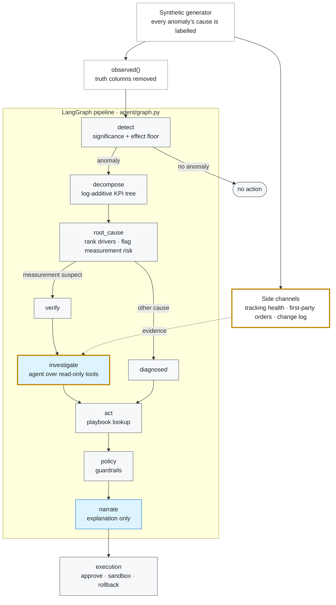

# campaign_agent

A diagnosis agent for product ads: detect anomalies in campaign performance,
decompose the KPI move, attribute a root cause, propose an action, and gate
that action behind policy and approval — evaluated end to end against known
ground truth.

Week 1 builds the foundation everything else is scored against: a synthetic
data generator whose anomalies are **labelled with their causes**.

## Architecture at a glance



<sub>**Grey:** deterministic code. **Blue:** a model runs here. **Gold border:** added with the investigator ([§10](ARCHITECTURE.md#10-build-plan-investigator-agent--harness)). **Dashed arrow:** read-only evidence.</sub>

The design rationale, the safety argument and the eval results are in
[ARCHITECTURE.md](ARCHITECTURE.md).

## Billing model: CPC

The advertiser pays per click. That is not a detail — it determines which
metrics can move each other.

```
clicks      = impressions × ctr
spend       = clicks × cpc
conversions = clicks × cvr
revenue     = conversions × aov

⇒  cpa  = spend / conversions = cpc / cvr
⇒  roas = revenue / spend     = (cvr × aov) / cpc
```

Two consequences that drive the whole design:

- **CPA depends on exactly two drivers: `cpc` and `cvr`.** Nothing else can
  move it.
- **CTR appears in neither CPA nor ROAS.** Under CPC billing a CTR drop is a
  *volume* problem: fewer clicks, proportionally less spend, identical cost
  per conversion. An agent that answers a CTR drop with a bid change has
  misread the billing model — and `test_ctr_drop_is_a_volume_event_and_does_not_touch_cpa`
  is what keeps this dataset able to prove it.

`impressions` and `ctr` set volume. `cpc`, `cvr` and `aov` set efficiency.
Which bucket an anomaly falls in is half the root-cause answer.

## Why synthetic

> I need data where the root cause of every anomaly is known. That data does
> not exist in the wild — no production ads log carries a column saying *this
> CPA spike was a competitor entering the auction*. Synthetic generation is
> not a shortcut around real data here; it is the only way the problem becomes
> evaluable at all.

The obvious follow-up — *isn't it easy to make your own agent look good?* —
is answered by four design choices:

| Choice | What it prevents |
|---|---|
| Anomalies injected on **drivers**, never on reported outcomes | Attribution being tautological rather than well-posed |
| Overlapping events on one campaign | "Name the largest delta" being a winning strategy |
| Counts sampled (Poisson / Binomial), not rounded | "Is this drop significant?" degenerating into a tuned threshold |
| One pure **measurement artifact** scenario | An eval that only rewards confidence, never correctness |

## Layout

```
data/schema.py           metric identities, CampaignSpec, observed/truth split
data/events.py           the KINDS registry (= the answer key), Event, manifest i/o
data/synth.py            the generator, the default portfolio, the demo scenarios
data/telemetry.py        side channels: tracking health, first-party orders, change log
agent/                   detect → decompose → root_cause → act → policy → execution (+ graph.py)
agent/harness/           domain-free agent runtime: tools + tiers, loop + budgets, hooks, trace
agent/investigator/      the investigator agent: read-only tools, evidence guard, policy hook
tools/inspect_events.py  what each labelled event did to the data
tests/                   the specification
notes/                   interview talking points, three lines per week
```

## Run

```bash
python -m pytest tests/ -q                      # 172 passed + 3 skipped (LLM tests need a key)
python -m data.synth --days 120 --out ./generated
python -m tools.inspect_events                  # before/after per labelled event
```

Check you are not fitting tolerances to one dataset:

```bash
for i in $(seq 1 20); do SEED_OFFSET=$i python -m pytest tests/ -q || break; done
```

## Output

| file | contents | who reads it |
|---|---|---|
| `generated/campaigns.csv` | reported metrics only | the agent |
| `generated/campaigns_full.csv` | + true conversions, + realized parameters | scoring, debugging |
| `generated/manifest.json` | every injected event, labelled | weeks 4, 7, 11 |

`observed()` in `schema.py` is the seam that keeps evaluation honest. If agent
code can reach `conversions_true`, every score it produces is meaningless — so
reaching it has to require deliberately going around a function named
`observed`.

## The manifest is the point

Each event carries the answers later weeks are graded against:

```json
{
  "event_id": "e004",
  "kind": "tracking_outage",
  "campaign_id": "c_beauty_us",
  "start": "2026-05-25", "end": "2026-05-29",
  "root_cause_driver": "reporting_rate",   // week 4 scores attribution
  "bucket": "measurement",
  "surfaces_on": ["conversions", "revenue", "cpa", "roas"],
  "correct_action": "no_action_fix_measurement",  // week 7 scores actions
  "is_measurement_artifact": true          // week 11's sharpest case
}
```

Every field is derived from the `KINDS` registry rather than typed per event.
Hand-typing the correct action per event is how an answer key silently
develops errors, and an answer key with errors is worse than no answer key.

## The scenario that matters most

`e004`, the tracking outage. The conversion postback pipeline degrades: only
35% of conversions get reported. Reported CPA goes $7.80 → $23.55 (**+202%**)
and reported ROAS 5.51 → 1.80 (**−67%**) — while clicks move +1%, spend +3%,
and true CPA +6%. The real funnel is completely flat.

Every confident action here (cut bids, pause the campaign) destroys healthy
volume. The observed data fully supports the wrong conclusion; only the truth
columns say otherwise.

This is the case worth building the whole harness for. Catching it is worth
more than moving accuracy from 88% to 91%, because it is the failure mode
where a confident agent does real damage.

## Roadmap

| Week | Deliverable |
|---|---|
| 1 | Synthetic data + labelled manifest — **done** |
| 1b | Cross-validation scenario suite (`data/scenarios.py`) — **done** |
| 2 | Anomaly detection (significance, not thresholds) — **done** (`agent/detect.py`) |
| 3 | KPI decomposition down the identity tree — **done** (`agent/decompose.py`) |
| 4 | Root-cause engine, scored against `root_cause_driver` — **done** (`agent/root_cause.py`) |
| 5 | LangGraph state graph — **done** (`agent/graph.py`) |
| 6 | Evidence-grounded diagnosis — **done** (`agent/diagnosis.py`, LLM node; live tests need a key) |
| 7 | Action generation, scored against `correct_action` — **done** (`agent/actions.py`) |
| 8 | Impact simulator — **done** (`agent/impact.py`) |
| 9 | Policy engine (guardrails), most-restrictive-wins — **done** (`agent/policy.py`) |
| 10 | Approval / sandbox / rollback — **done** (`agent/execution.py`) |
| 11 | Evaluation harness over the cross-validation suite — **done** (`tools/evaluate.py`) |
| 12 | Productionize + demo — **done** (`demo.py`, [`ARCHITECTURE.md`](ARCHITECTURE.md)) |
| 13 | Investigator agent + harness on the verify branch — **done** (`agent/harness/`, `agent/investigator/`, [ARCHITECTURE §10](ARCHITECTURE.md#10-build-plan-investigator-agent--harness)) |

## The whole thing, end to end

```bash
python demo.py                     # the trap walked through every stage (offline)
python -m tools.evaluate --n 20    # the full graded harness
python webui.py                    # a browser UI to ask questions (see below)

python -m tools.ask --event e004 --investigator heuristic        # agent on the verify branch
python -m tools.evaluate --n 20 --investigator heuristic         # rule baseline, offline
python -m tools.evaluate --n 20 --investigator llm --trace-dir traces/   # Claude, needs a key
```

[`ARCHITECTURE.md`](ARCHITECTURE.md) is the design rationale: the deterministic-core /
LLM-overlay pattern, why the trap is defended in two independent places, and the eval
methodology. Headline results over 20 cross-validation scenarios: **100% detection,
100% root-cause & action accuracy, 3.3% false-positive rate, and — the metric that
matters — 0% harmful actions on measurement artifacts with a proposed cut blocked and
refused 100% of the time.**

### Investigator agent

The pipeline above stops at "verify measurement" on a CVR collapse, because the
reported numbers cannot separate a tracking outage from a real checkout break. The
investigator is an agent loop that resolves it with read-only tools over side
channels (tracking health, first-party orders, change log, peers). It runs on a
small harness built for this: allowlisted tools with permission tiers, step / token /
time budgets, `policy.py` as a PreToolUse hook, an evidence guard that rejects
verdicts citing calls that never ran, and a JSONL trace per run. A verdict only
selects between two non-money playbook rows; anything unvalidated falls back to
verify. The safety rows above are unchanged with the agent wired in.
