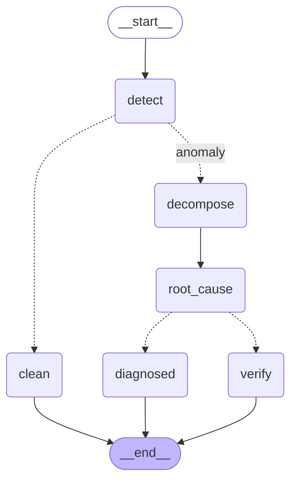

# Diagnosis graph flow (week 5)

The state machine in `agent/graph.py`. The mermaid below is **generated from the
compiled graph** (`build_graph().get_graph().draw_mermaid()`), so it cannot drift
from the code — regenerate it if the topology changes.

Dashed edges are **conditional** (a routing function decides which one is taken);
solid edges are unconditional.

## Nodes

| node | does | week |
|---|---|---|
| `detect` | significance test over all metrics for the campaign | 2 |
| `clean` | terminal: nothing moved beyond sampling noise | — |
| `decompose` | log-additive breakdown of every KPI that moved (the evidence) | 3 |
| `root_cause` | attribute to the significant driver(s); set `measurement_suspect` | 4 |
| `verify` | terminal gate: measurement check required before any action | 5 |
| `diagnosed` | terminal: a plain, actionable diagnosis | 5 |

## The two routing decisions

- **`route_after_detect`** — `clean` if no metric cleared significance, else
  `anomaly`. A clean campaign never touches decomposition or attribution; the
  graph does the cheap check first and exits.
- **`route_after_root`** — `verify` if `root.measurement_suspect` is set (the
  CVR-collapse signature, indistinguishable from a tracking outage), else
  `diagnosed`. **This is the load-bearing edge.** Because it lives in the graph's
  topology, you can prove from the diagram alone that a tracking-outage-shaped
  anomaly cannot reach any future action node without first passing measurement
  verification. The safety property is structural, not a check some node might
  forget to run.

## Why a graph for a mostly-linear pipeline

The linearity is week 5's; the later weeks are not. `diagnosed` grows an LLM
diagnosis node (week 6) and an action node (week 7); `verify` becomes a real
measurement-verification tool call (week 10); a policy gate (week 9) and an
approval/rollback loop (week 10) slot in as nodes and conditional edges. Each is
an addition to this graph, not a rewrite of a monolithic function — which is the
entire reason to pay the graph's overhead now.
